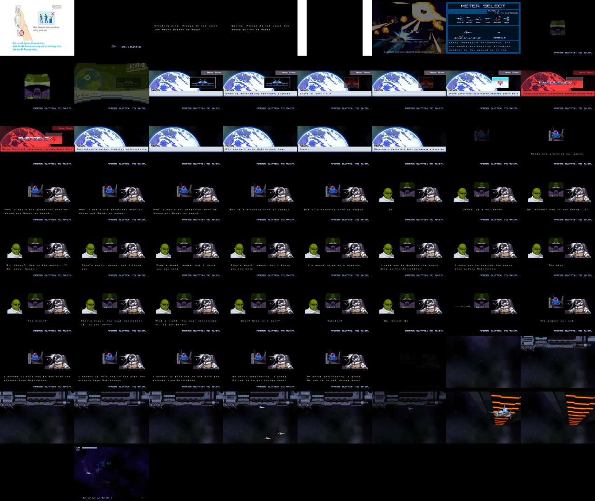

# Gradius ReBirth (Updated, v257) - native recompilation

A static recompilation of **Gradius ReBirth (Updated, v257)** (WiiWare, NTSC-U, title `WGRE`) to native code. The game's
PowerPC executable is translated to C++ and runs on Windows (and Linux) with a small runtime that
replaces the Wii hardware, IOS and the DSP.



**No game data is included.** You need your own copy of the game as a WAD. The build turns your WAD
into a `game` folder and generates the C++ from the executable inside it.

## Status

- Boots through the health screen, Konami logo, save creation, title menu and gameplay (headless Linux
  test build).
- A Windows build has been produced but not yet play-tested on Windows. Audio has not been verified by ear.
- v0.2: fixes carried over from Chocobo's Dungeon - audio (no dropped audio periods, DSP-done
  delivered first, 60 ms jitter buffer), game speed 1x-8x (the unlimited mode could lock the game),
  depth and format EFB copies.

Shares its recompiler and runtime with
[chocobo-dungeon-recomp](https://github.com/darkuni/chocobo-dungeon-recomp) and the ReBirth ports;
per-game addresses are in `src/runtime/game.h` and the idle loop in `src/recomp.py`.
See [NOTES.md](NOTES.md) for the technical write-up.

## Layout

| Path | What it is |
| --- | --- |
| `src/recomp.py` | Recompiler: `main.dol` + symbols -> `src/gen/*.cpp` |
| `src/runtime/` | Runtime: CPU context and memory, threads, IOS, GX -> OpenGL 3.3, AX audio, input |
| `src/runtime/game.h` | Game-specific addresses the runtime needs |
| `src/hle.txt` | Guest functions replaced by host code or stubbed |
| `config/` | Symbols and decomp-toolkit (dtk) project files |
| `tools/prepare_wad.py` | Unpacks a WAD into the `game` folder |

## Building

Requirements: Python 3.11+, `pip install libWiiPy`, CMake, Ninja, a C++17 compiler; Windows builds are
cross-compiled with mingw-w64 (posix threads) and the SDL2 mingw development package.

```sh
python3 tools/prepare_wad.py <your>.wad game
cd src
python3 recomp.py ../game/main.dol symbols.txt gen 300
cmake -S . -B build-win -G Ninja -DCMAKE_TOOLCHAIN_FILE=mingw.cmake \
      -DSDL2_DIR=/path/to/SDL2-2.30.x/x86_64-w64-mingw32
ninja -C build-win -j1
# Linux headless test build:
cmake -S . -B build -G Ninja -DCMAKE_CXX_COMPILER=clang++ && ninja -C build
SHOT_EVERY=150 SHOT_DIR=shots TIMEOUT=120 ./build/gradius ../game
```

Ship `gradius.exe` with `SDL2.dll`, `libwinpthread-1.dll` and `src/runtime/ipl-font-licenses.txt` next to
a `game` folder.

## Disclaimer

This is an unofficial fan project. It is **not affiliated with, endorsed by, or sponsored by** Konami Digital Entertainment, M2 Co., Ltd.
or Nintendo. *Gradius ReBirth* and all related names and marks belong to their respective owners. This
repository contains no game code or game data; you need your own legally obtained copy of the game.

## License

The project's own code is released under the [MIT License](LICENSE). Bundled third-party
components (fonts, OpenGL headers) keep their own licenses; see
[THIRD_PARTY_NOTICES.md](THIRD_PARTY_NOTICES.md).
